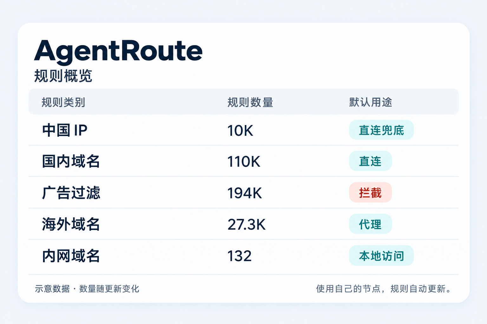

# AgentRoute · 智能体分流规则

[](https://github.com/Heibai0502/agent-route/actions/workflows/run.yml)

**自动更新分流规则，用你自己的节点，交给 Agent 帮你接入。**

[复制提示词](#agent-prompt) · [客户端接入](docs/CLIENTS.md) · [DNS / WebRTC 防护](docs/DNS-WEBRTC.md)

<a id="about"></a>

## 有什么用？

AgentRoute 整理开源社区的**中国 IP、国内域名、海外域名、广告名单和内网域名**，转换成 Mihomo / Clash Meta、Surge / Shadowrocket、sing-box 可用的规则格式。

默认示例用于**国内直连、海外走代理、过滤名单广告、保留内网访问**，你自己的明确例外优先。仓库每天计划更新，校验失败保留上一份有效数据；客户端接入后通常每 24 小时检查更新。

**节点由你自己提供。** 如果想使用美国等地区的出口，选择自己的对应节点即可；这里没有单独的美国 IP 直连名单，也不提供机场订阅。支持版本与各客户端差异见 [接入说明](docs/CLIENTS.md)。



*根据示例截图优化的规则概览，非实时状态；数量以[最新发布清单](https://raw.githubusercontent.com/Heibai0502/agent-route/release/manifest.json)为准。*

<a id="agent-prompt"></a>

## 复制给自己的 Agent

复制下面整段提示词，让 Agent 根据你的设备和现有配置完成接入。需要手动操作时，它应明确告诉你具体步骤。

```text
请帮我接入 AgentRoute：
https://github.com/Heibai0502/agent-route

先阅读仓库的 AGENTS.md、docs/SYNC.md、docs/CLIENTS.md 和 docs/DNS-WEBRTC.md，再按以下要求实际配置并验证：

1. 识别我的系统、代理客户端及核心版本、浏览器配置档、DNS、IPv6 和代理/TUN 状态；备份将修改的配置，缺少关键信息时再问我。

2. 保留我的节点、订阅、认证信息、代理组成员、当前选择、LAN 和明确例外。选择兼容的规则格式，将 PROXY/DIRECT 映射到我的实际策略，只合并必要内容，不能用示例覆盖整份配置。不要索取项目维护者的密钥。

3. 按文档配置规则优先级和约 24 小时自动刷新，并确认资源已加载。需要严格同代同步时，使用仓库工具固定 release SHA、校验清单后整批应用；失败保留上一有效版本。下载成功不等于客户端已更新。

4. 检查并修复 DNS：内网本地解析，国内按预期直连解析，海外和未知域名的解析经过我的代理；节点域名单独引导。核对浏览器安全 DNS、备用解析器、FakeIP 和 IPv6，不能把 DoH 加密等同于已走代理，也不能静默添加直连或明文回退。

5. 支持扩展的 Chrome/Chromium 使用 Google 的 WebRTC Network Limiter，选择 Disable non-proxied UDP（disable_non_proxied_udp），核对当前配置档及重启后保持。遇到不支持的浏览器、安装交互或企业策略限制，说明具体情况，不绕过限制。

6. 保持我现用的代理开启，分别验证规则加载、网页出口、DNS、IPv4/IPv6、WebRTC ICE 候选和必要的音视频功能。没有候选或检测页空白不代表没有泄露。最后说明改动、规则版本、刷新方式、验证结果、回退位置和未验证事项。
```

## 详细文档

- [Agent 接入入口](AGENTS.md)：读取顺序、执行步骤与验收要求。
- [同步与回退工具](docs/SYNC.md)：sync / verify / status / rollback。
- [规则索引](https://raw.githubusercontent.com/Heibai0502/agent-route/release/index.json)：各客户端的资源地址与校验信息。
- [维护说明](docs/MAINTAINING.md)：构建、测试与发布流程。

## 开源来源与致谢

本项目基于 [Loyalsoldier](https://github.com/Loyalsoldier)、[v2fly](https://github.com/v2fly/domain-list-community)、[gaoyifan](https://github.com/gaoyifan/china-operator-ip) 等作者和社区的成果，增加来源整理、冲突处理、格式转换、自动校验及 Agent 接入工具。

完整上游项目、贡献者、许可声明和原文见 [NOTICE](NOTICE.md)、[sources.json](sources.json) 与 [licenses](licenses/)。本项目的 [LICENSE](LICENSE) 不替代上游各自的许可声明。
